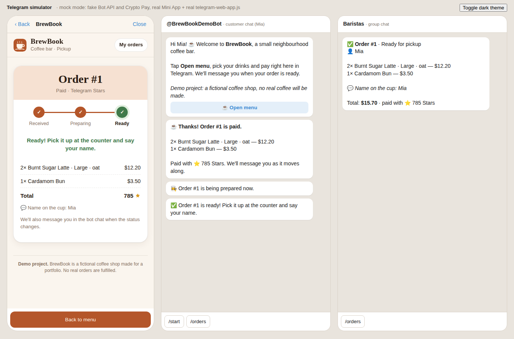
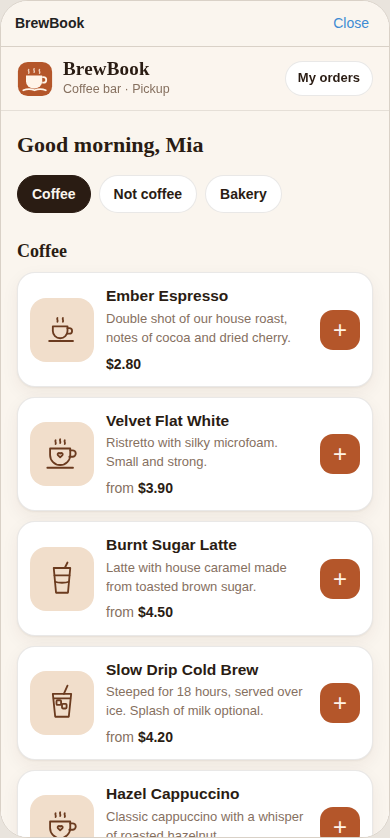
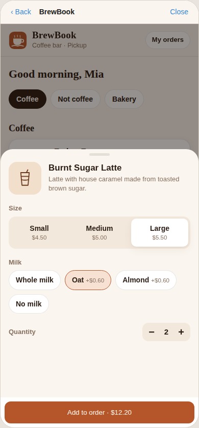
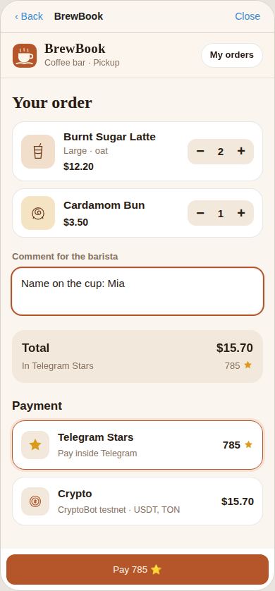
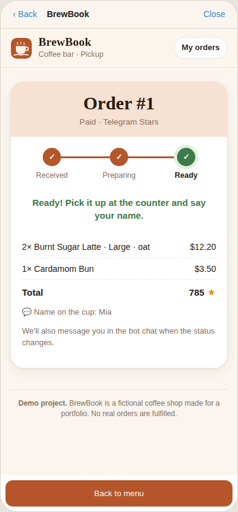
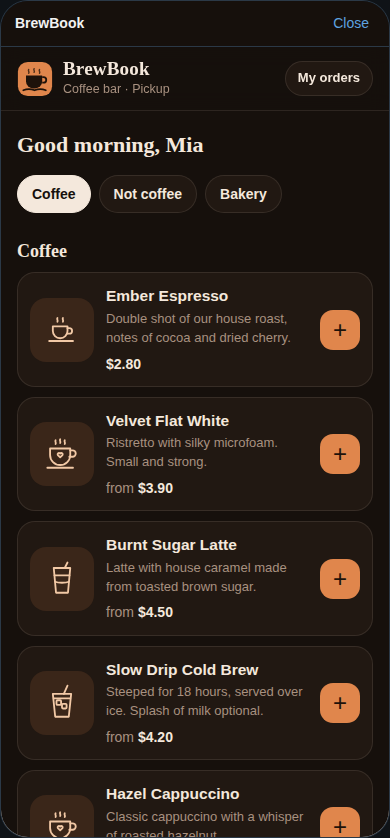

# BrewBook ☕ — Telegram Mini App for a coffee shop

> **Demo project.** BrewBook is a fictional coffee shop built for a portfolio.
> The menu, names and visuals are original; no real brand assets are used and no real orders are fulfilled.

Customers open the menu from a Telegram bot, pick drinks with size and milk options, and pay without leaving Telegram:
with **Telegram Stars** or with **crypto via Crypto Pay (CryptoBot testnet)**. The paid order lands in a baristas' group chat
with buttons to move it through *New → Preparing → Ready*, and the customer gets a message at every step.



| Menu (light) | Options | Cart | Order status | Menu (dark) |
|---|---|---|---|---|
|  |  |  |  |  |

## Features

- `/start` greets the customer with an **Open menu** button (`web_app` button) and sets the chat menu button.
- **Menu**: 12 fictional items in 3 categories (Coffee, Not coffee, Bakery), sizes S/M/L and milk options with surcharges.
- **Cart**: quantity steppers, comment for the barista, total in dollars and in Stars. Uses Telegram **MainButton** and **BackButton**,
  haptics, and follows Telegram's **light/dark theme** live (`themeChanged`).
- **Payments**
  1. **Telegram Stars** (`XTR`): the server creates an invoice link, the app opens it with `openInvoice`, the bot validates
     `pre_checkout_query` (order exists, belongs to this user, unpaid, exact amount) and records `successful_payment`.
  2. **Crypto Pay API** on **testnet**: fiat-priced invoice (USD, paid in USDT/TON), confirmed by a signed webhook or by polling.
     If Crypto Pay isn't configured or doesn't answer, the app shows a clearly labelled **Demo payment** button instead.
- **After payment**: the order is stored in SQLite with status `new → preparing → ready`; the baristas' chat gets a formatted
  card with inline buttons; the customer gets a message on every status change; the Mini App ticket updates live.
- **Owner view**: `/orders` lists the 10 most recent orders (for `OWNER_IDS`, or anyone inside the barista chat).
- **Browser demo mode** (optional): the Mini App also opens in a normal browser as a guest, for a public portfolio link.

## Security and quality

- **Every `/api` call is authenticated with Telegram `initData`**, validated on the server with
  HMAC-SHA256 (`secret = HMAC("WebAppData", BOT_TOKEN)`), constant-time comparison and a 24 h freshness limit.
  The user id always comes from the signed data; ids, prices or totals sent by the client are ignored.
- Prices are recomputed on the server from the menu; unknown items, options or quantities are rejected.
- A customer can only see and pay their own orders (others get 404, so ids can't be probed).
- Payments are idempotent: a conditional `UPDATE … WHERE status = 'awaiting_payment'` means retries of
  `successful_payment` or the Crypto Pay webhook never double-notify. Crypto Pay webhooks are checked with
  `HMAC-SHA256(key = SHA256(token), body)`.
- Status buttons work only inside the configured barista chat and only move forward.
- User-supplied text is HTML-escaped in every bot message. A customer who blocked the bot doesn't break payment handling.
- Secrets only come from environment variables (see `.env.example`); nothing secret is in the code.

## Project layout

```
app/
  main.py         FastAPI app + bot long polling in one process
  api.py          Mini App API (initData auth), Crypto Pay webhook
  auth.py         initData validation
  orders.py       order rules, statuses, message texts, notifications
  menu.py         fictional menu + option prices
  seed.py         python -m app.seed  (creates tables, loads the menu)
  cryptopay.py    minimal Crypto Pay API client + webhook signature check
  bot/handlers.py /start, /orders, Stars pre-checkout + payment, barista buttons
webapp/           index.html, app.css, app.js (plain JS, telegram-web-app.js, no build step)
tests/            pytest: auth, API, payments, bot (Telegram and Crypto Pay faked)
devtools/         mock server + Telegram simulator page + Playwright end-to-end script
```

## 1. Create the bot (BotFather)

1. Open [@BotFather](https://t.me/BotFather) → `/newbot` → pick a name and a username. Copy the token into `BOT_TOKEN`.
2. Optional polish: `/setuserpic`, `/setdescription` ("Demo coffee shop: order and pay inside Telegram").
3. Nothing to configure for Stars: Stars invoices need no payment provider token.
4. Barista chat: create a group, add the bot, send any message, then get the chat id (e.g. forward a message to
   [@userinfobot](https://t.me/userinfobot) or look at `getUpdates`). Put the negative id into `BARISTA_CHAT_ID`.
5. Your own user id goes into `OWNER_IDS` (for `/orders`).

The app sets the bot commands and the chat menu button itself on startup.

> **About Stars and physical goods.** Telegram requires Stars for *digital* goods; real coffee is a physical good and in
> production should go through a payment provider (BotFather → Payments). Stars are used here to demo the flow.
> Use `STARS_PER_USD=1` while testing so a test order costs only a few Stars.

## 2. Crypto Pay (testnet)

1. Open [@CryptoTestnetBot](https://t.me/CryptoTestnetBot) → **Crypto Pay** → **Create App**, copy the token into `CRYPTOPAY_TOKEN`,
   keep `CRYPTOPAY_NETWORK=testnet`.
2. In the app settings enable **Webhooks** and set the URL to `https://<your-domain>/cryptopay/webhook`.
   (Without a webhook the Mini App still detects the payment by polling `getInvoices` while the customer waits.)
3. Test coins come from the testnet bot itself. Leave `CRYPTOPAY_TOKEN` empty to see the demo-payment fallback.

## 3. Run locally with a tunnel

Telegram only opens Mini Apps over HTTPS, so expose your local port with a tunnel.

```bash
python3.11 -m venv .venv && source .venv/bin/activate
pip install -r requirements-dev.txt
cp .env.example .env              # fill BOT_TOKEN, BARISTA_CHAT_ID, OWNER_IDS
python -m app.seed

# in a second terminal
cloudflared tunnel --url http://localhost:8000      # or: ngrok http 8000
# put https://<random>.trycloudflare.com/app/ into WEBAPP_URL in .env

uvicorn app.main:app --port 8000
```

Send `/start` to your bot and tap **Open menu**. The bot runs with long polling inside the same process, so no
webhook setup is needed for the bot itself. Restart after changing `WEBAPP_URL` so the menu button updates.

### Without a bot token: mock mode

```bash
python -m devtools.mock_telegram          # open http://localhost:8000/dev/
CRYPTO=off python -m devtools.mock_telegram   # simulate "crypto unavailable" -> demo payment
```

This runs the real app with the Bot API and Crypto Pay replaced by fakes, and serves a simulator page: the Mini App in
a phone frame with the real `telegram-web-app.js` (it talks to the page over `postMessage`, the same way Telegram Web
hosts Mini Apps), the customer chat and the baristas' chat with working buttons. Local use only.

## 4. Tests

```bash
pytest                                     # 30 tests: initData, API, Stars, Crypto Pay, demo pay, bot handlers
python -m devtools.mock_telegram &         # then, with Playwright installed (npm i playwright):
node devtools/e2e.mjs                      # clicks through every flow in Chromium, writes docs/*.png
```

## 5. Docker

```bash
docker build -t brewbook .
docker run --env-file .env -p 8000:8000 -v brewbook-data:/data brewbook
```

The image seeds the menu on start and keeps SQLite on `/data`.

## 6. Deploy to Railway

1. Push this folder to a GitHub repo, then Railway → **New Project → Deploy from GitHub repo** (or `railway up` with the CLI).
   `railway.json` tells Railway to build the `Dockerfile` and health-check `/health`.
2. Service → **Settings → Networking → Generate Domain**.
3. Service → **Volumes → Add volume**, mount path `/data` (SQLite survives redeploys).
4. Service → **Variables**: `BOT_TOKEN`, `WEBAPP_URL=https://<domain>/app/`, `BARISTA_CHAT_ID`, `OWNER_IDS`,
   `CRYPTOPAY_TOKEN`, `CRYPTOPAY_NETWORK=testnet`, `STARS_PER_USD`, optionally `BROWSER_DEMO=true`.
   `DATABASE_URL` is already set to `/data` by the Dockerfile.
5. Keep **1 replica**: the bot uses long polling, and two pollers would fight over updates.
6. Set the Crypto Pay webhook to `https://<domain>/cryptopay/webhook`, then `/start` the bot.

## What to record for a 40-second portfolio video

Record a phone screen (Telegram mobile, light theme) with the barista group open on a second device or in Telegram Desktop.
The mock simulator at `/dev/` shows all three panes side by side if you prefer a single desktop capture.

| Time | Shot | What to show |
|---|---|---|
| 0–4 s | Bot chat | Send `/start`, the welcome message with **Open menu** appears. Caption: *"Coffee ordering inside Telegram"* |
| 4–12 s | Menu | Mini App opens; scroll the menu, tap a category chip, open **Burnt Sugar Latte**, pick Large + Oat, quantity 2. Show the MainButton price updating. |
| 12–17 s | Cart | Add a Cardamom Bun, open the cart, change a quantity, type a comment. Caption: *"Server-side prices, Telegram MainButton"* |
| 17–24 s | Stars payment | Tap **Pay ⭐**, confirm the native Stars sheet, the order ticket appears with "Received". |
| 24–32 s | Barista chat | Cut to the barista group: the order card arrives; tap **Preparing**, then **Ready**. |
| 32–37 s | Customer side | Back on the phone: ticket turns green "Ready", status messages in the bot chat. |
| 37–40 s | Dark theme + end card | Switch Telegram to dark mode, the app follows. End card: *"BrewBook · Demo project · aiogram 3 + FastAPI + Mini App"* |

Optional 5-second insert: choose **Crypto**, show the CryptoBot testnet invoice (or the labelled demo payment).

## Configuration reference

| Variable | Default | Meaning |
|---|---|---|
| `BOT_TOKEN` | — | Bot token from BotFather (required in Telegram) |
| `WEBAPP_URL` | — | Public HTTPS URL of `/app/` |
| `DATABASE_URL` | `sqlite+aiosqlite:///./brewbook.db` | SQLite path |
| `BARISTA_CHAT_ID` | — | Group chat id for new orders |
| `OWNER_IDS` | — | Comma-separated ids allowed to use `/orders` |
| `CURRENCY` | `USD` | Menu currency (also the Crypto Pay fiat) |
| `STARS_PER_USD` | `50` | Stars price = ceil(USD × rate) |
| `CRYPTOPAY_TOKEN` | — | Crypto Pay app token; empty = demo fallback |
| `CRYPTOPAY_NETWORK` | `testnet` | `testnet` or `mainnet` |
| `CRYPTOPAY_ASSETS` | `USDT,TON` | Accepted assets |
| `DEMO_PAYMENTS` | `true` | Allow the labelled demo payment when crypto is unavailable |
| `BROWSER_DEMO` | `false` | Allow guest access from a normal browser |
| `RUN_BOT` | `true` | Run long polling in this process |

## Limitations (it's a demo)

- No refunds (`refundStarPayment`), no stock or opening hours, no multi-shop admin panel.
- Orders that are never paid stay in `awaiting_payment`; a cleanup job would be the next step.
- SQLite and a single process are deliberate for a small demo; Postgres plus a webhook-mode bot would be the production path.

---

**Demo project** · fictional coffee shop · made for a portfolio.
